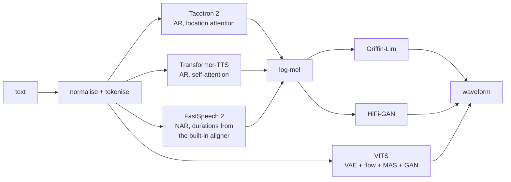
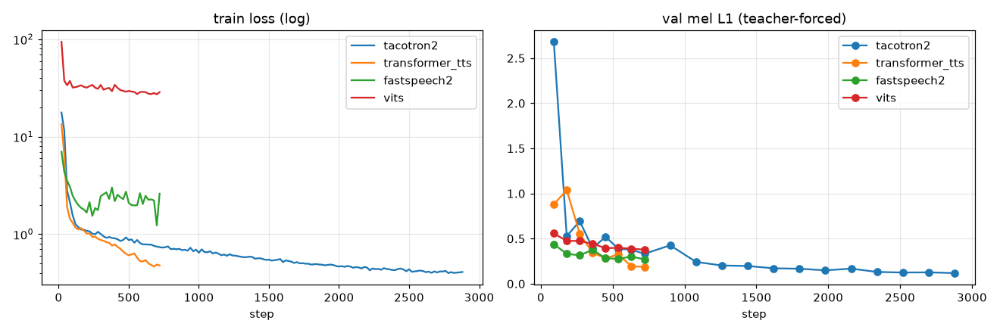
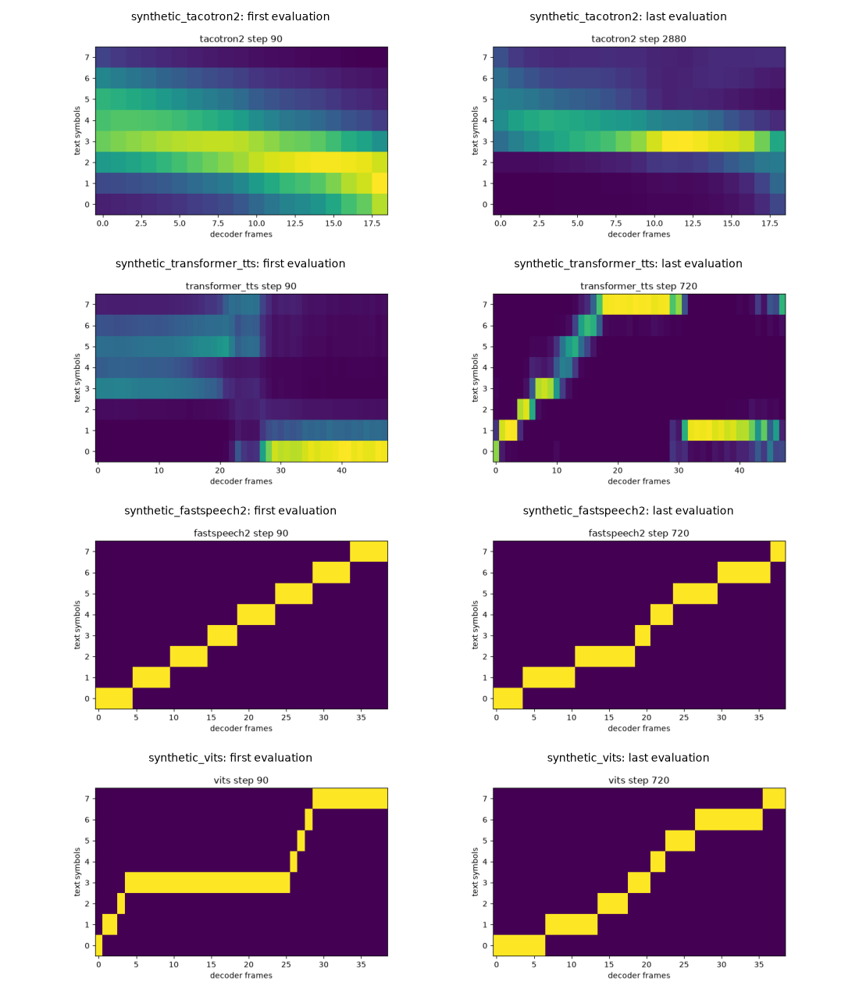
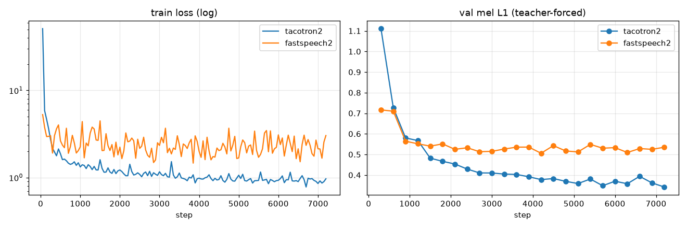
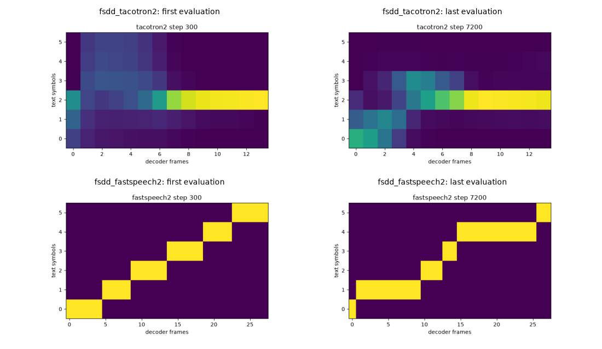

# tts-workbench

**Every main text-to-speech approach in one small, readable PyTorch code base, built to
understand how each one works: Tacotron 2, Transformer-TTS, FastSpeech 2, VITS and a
HiFi-GAN vocoder, with a built-in aligner, MCD / F0 / WER / MOS evaluation and a Kaggle/Colab
notebook.**

[](LICENSE)
[](pyproject.toml)
[](https://pytorch.org)
[](docs/testing.md)

The models are deliberately small (about one million parameters each by default) so that a
run on a laptop CPU or a free GPU shows what the method does, and so that every line can be
read. Each model file starts with a docstring that explains the architecture and the
equations; [docs/architecture.md](docs/architecture.md) compares them.



| approach | file | what you learn from it |
|---|---|---|
| **Tacotron 2** | `src/tts/tacotron2.py` | autoregressive decoding, teacher forcing, location-sensitive attention, prenet dropout, stop token, postnet |
| **Transformer-TTS** | `src/tts/transformer_tts.py` | the same with self-attention, causal masks, scaled positional encodings, why guided attention is needed |
| **FastSpeech 2** | `src/tts/fastspeech2.py` | non-autoregressive synthesis, length regulation, duration/pitch/energy predictors, variance information |
| **built-in aligner + MAS** | `src/tts/align.py` | monotonic alignment search, the forward-sum (CTC) loss, teacher durations from attention |
| **VITS** | `src/tts/vits.py` | conditional VAE, posterior encoder, normalising flow (coupling layers), MAS on a latent, end-to-end GAN training |
| **HiFi-GAN** | `src/tts/vocoders.py`, `src/tts/losses.py` | neural vocoding, multi-receptive-field fusion, multi-period and multi-scale discriminators, feature matching |
| **Griffin-Lim, mel, F0** | `src/tts/audio.py` | STFT, mel filterbanks, phase reconstruction, autocorrelation pitch tracking |
| **metrics** | `src/tts/metrics.py` | MCD with DTW, log-F0 RMSE, attention diagonality, WER through Whisper, predicted MOS (UTMOS) |

Every model has a multi-speaker option (a learned speaker embedding), every mel model works
with either vocoder, and all of them share the same data layout, trainer, checkpoint format
and evaluation.

> **No pretrained weights are published.** Train on the built-in datasets or your own
> ([docs/data.md](docs/data.md)). Real training (LJSpeech, hundreds of epochs) is meant for the
> Kaggle/Colab notebook; the runs below are short CPU checks.

## Quick start

```bash
git clone https://github.com/benisalla/tts-workbench.git && cd tts-workbench
uv venv .venv && VIRTUAL_ENV=.venv uv pip install -e ".[dev]"      # or: pip install -e ".[dev]"

tts-data synthetic --out data/synthetic                              # toy spoken language, 8 kHz, 2 MB
tts-train --model fastspeech2 --data-dir data/synthetic --output-dir checkpoints/fs2 --epochs 40
tts-synthesize --checkpoint checkpoints/fs2/best.pt --text "ba ko mi tu" --out synthesized/
tts-eval --checkpoint checkpoints/fs2/best.pt --data-dir data/synthetic --n 15
```

Swap `--model` for `tacotron2`, `transformer_tts`, `vits` or `hifigan`; add
`--vocoder hifigan --vocoder-checkpoint checkpoints/hifigan/best.pt` to `tts-synthesize` once a
vocoder is trained. Every field of `src/tts/config.py` is a flag (`--hidden 256 --layers 4 ...`).

Real speech to try on this scale: `tts-data fsdd` (3,000 spoken digits, 8 kHz, 20 MB) and
`tts-data yesno` (60 clips, 4.5 MB). For LJSpeech use the notebook.

## Kaggle / Colab notebook

[`notebooks/train_colab_kaggle.ipynb`](notebooks/train_colab_kaggle.ipynb) is generated from
`src/` by `notebooks/build_notebook.py`, so it contains exactly this code. Choose `MODEL`,
`DOWNLOAD_DATASET` (`ljspeech`, `fsdd`, `yesno`) and the audio settings in one cell; it trains
with a time budget, draws the curves and the alignment, plays the synthesized sentences and
scores them (MCD, F0, WER with Whisper, predicted MOS with UTMOS). Its checkpoints work with
`tts-synthesize` and `tts-eval` here.

## Results

These are short CPU runs (two threads, minutes each) on 8 kHz data. Their purpose is to show
that every model learns and that the metrics and plots mean something, not to compete with
LJSpeech numbers. `python scripts/results_table.py synthetic|fsdd` prints the tables from
`results/summary.json`; the commands are in [docs/training.md](docs/training.md).

Columns: `val mel L1` is the teacher-forced validation error, first and last evaluation
(the one term every model shares). The rest are measured on free-running synthesis of 15
validation sentences against the recordings, along a DTW path
([docs/evaluation.md](docs/evaluation.md)): MCD in dB, log-F0 RMSE in semitones, the share
of frames with a voicing mismatch, the relative length error, and the share of attention
mass near the diagonal (the MAS path for FastSpeech 2 / VITS).

### Synthetic toy language (300 sentences, 285 train / 15 val, 8 kHz)

| model | vocoder | params | steps | val mel L1 (first → last) | MCD (dB) | log-F0 RMSE (st) | voicing err. | duration err. | alignment diag. |
|---|---|---|---|---|---|---|---|---|---|
| `tacotron2` | Griffin-Lim | 0.9 M | 2880 | 2.68 → 0.12 | 18.8 | 6.1 | 0.14 | 0.04 | 0.17 |
| `tacotron2` | HiFi-GAN | 0.9 M | 2880 | 2.68 → 0.12 | 18.6 | 16.4 | 0.14 | 0.03 | 0.17 |
| `transformer-tts` | Griffin-Lim | 1.4 M | 720 | 0.88 → 0.19 | 13.0 | 4.6 | 0.06 | 0.04 | 0.91 |
| `transformer-tts` | HiFi-GAN | 1.4 M | 720 | 0.88 → 0.19 | 15.4 | 19.9 | 0.13 | 0.03 | 0.91 |
| `fastspeech2` | Griffin-Lim | 2.4 M | 720 | 0.44 → 0.27 | 12.3 | 3.0 | 0.04 | 0.05 | 0.97 |
| `fastspeech2` | HiFi-GAN | 2.4 M | 720 | 0.44 → 0.27 | 14.6 | 19.5 | 0.13 | 0.03 | 0.97 |
| `vits` | (end-to-end) | 3.1 M | 720 | 0.56 → 0.38 | 12.9 | 9.7 | 0.17 | 0.02 | 0.92 |
| `hifigan` (vocoder alone) | | | 540 | 0.52 → 0.44 | | | | | |

Reference points for MCD on this data (same metric, same 8 kHz mel settings):
- Griffin-Lim copy-synthesis of the *true* mel vs. the recording: **10.5 dB** (the floor a mel model + Griffin-Lim can reach).

- **Transformer-TTS, FastSpeech 2 and VITS all learn the language**: 12–13 dB MCD with
  Griffin-Lim against a 10.5 dB floor (copy-synthesis of the true mel), near-diagonal
  alignments (0.91–0.97) and 2–5 % length error. FastSpeech 2 has the best MCD and F0.
- **Tacotron 2 shows the classic failure of attention TTS**: its teacher-forced error is the
  lowest of all (0.12) because the decoder learns to copy the previous frame, but the
  attention never became diagonal (0.17), so free-running synthesis drifts (18.8 dB). The
  guided-attention loss and 160 epochs were not enough on 285 sentences; the alignment grid
  below shows it still attending to one symbol.
- **The HiFi-GAN vocoder is under-trained** (540 steps): with it, MCD rises by about 2 dB and
  the F0 error jumps to 16–20 semitones, which means the periodicity is not there yet. On this
  scale Griffin-Lim is the honest vocoder; HiFi-GAN needs hours on a GPU
  ([docs/training.md](docs/training.md)).





Listen (validation sentences, Griffin-Lim): recording
[toy0003](docs/audio/recording_toy0003.wav) /
[toy0034](docs/audio/recording_toy0034.wav), FastSpeech 2
[toy0003](docs/audio/synthetic_fastspeech2_griffinlim_toy0003_syn.wav) /
[toy0034](docs/audio/synthetic_fastspeech2_griffinlim_toy0034_syn.wav), VITS
[toy0003](docs/audio/synthetic_vits_griffinlim_toy0003_syn.wav) /
[toy0034](docs/audio/synthetic_vits_griffinlim_toy0034_syn.wav).

### FSDD: real spoken digits (one speaker, 500 clips, 475 train / 25 val, 8 kHz)

| model | vocoder | params | steps | val mel L1 (first → last) | MCD (dB) | log-F0 RMSE (st) | voicing err. | duration err. | alignment diag. |
|---|---|---|---|---|---|---|---|---|---|
| `fastspeech2` | Griffin-Lim | 2.4 M | 4200 | 0.72 → 0.51 | 31.9 | 9.1 | 0.10 | 0.21 | 0.40 |
| `fastspeech2` | HiFi-GAN | 2.4 M | 4200 | 0.72 → 0.51 | 33.5 | 13.3 | 0.15 | 0.19 | 0.40 |
| `tacotron2` | Griffin-Lim | 0.9 M | 7200 | 1.11 → 0.34 | 29.0 | 7.7 | 0.13 | 0.10 | 0.29 |
| `tacotron2` | HiFi-GAN | 0.9 M | 7200 | 1.11 → 0.34 | 34.0 | 13.4 | 0.14 | 0.09 | 0.29 |
| `hifigan` (vocoder alone) | | | 1200 | 1.01 → 0.83 | | | | | |

Reference points for MCD on this data (same metric, same 8 kHz mel settings):
- Griffin-Lim copy-synthesis of the *true* mel vs. the recording: **18.8 dB** (the floor a mel model + Griffin-Lim can reach).
- Another recording of the same text by the same speaker vs. the recording: **26.4 dB**, log-F0 RMSE 5.4 semitones (natural variation).

Tacotron 2: 240 epochs, 20 min. FastSpeech 2: 240 epochs, 26 min, best checkpoint at step
4 200. The two reference points say what the numbers mean: a model + Griffin-Lim cannot go
below 18.8 dB, and two recordings of the *same digit by the same speaker* already differ by
26.4 dB and 5.4 semitones. Both models sit a little above that natural variation (29–34 dB,
8–9 semitones): they produce the right digit at roughly the right length, with the melody of
an average take. 475 one-word clips are too few for a sharp alignment (0.29–0.40 diagonal):
the attention of Tacotron 2 is still blurry after 7 200 steps and the MAS path of FastSpeech 2
spends most frames on one or two symbols. The vocoder story is the same as above.





Listen: recording [0 (zero)](docs/audio/recording_0_jackson_32.wav) /
[1 (one)](docs/audio/recording_1_jackson_14.wav); Tacotron 2 + Griffin-Lim
[zero](docs/audio/fsdd_tacotron2_griffinlim_0_jackson_32_syn.wav) /
[one](docs/audio/fsdd_tacotron2_griffinlim_1_jackson_14_syn.wav), + HiFi-GAN
[zero](docs/audio/fsdd_tacotron2_hifigan_0_jackson_32_syn.wav) /
[one](docs/audio/fsdd_tacotron2_hifigan_1_jackson_14_syn.wav); FastSpeech 2 + Griffin-Lim
[zero](docs/audio/fsdd_fastspeech2_griffinlim_0_jackson_32_syn.wav) /
[one](docs/audio/fsdd_fastspeech2_griffinlim_1_jackson_14_syn.wav), + HiFi-GAN
[zero](docs/audio/fsdd_fastspeech2_hifigan_0_jackson_32_syn.wav) /
[one](docs/audio/fsdd_fastspeech2_hifigan_1_jackson_14_syn.wav).

## Documentation

| | |
|---|---|
| [docs/architecture.md](docs/architecture.md) | every model and vocoder: shapes, equations, why each piece exists, trade-offs |
| [docs/alignment.md](docs/alignment.md) | attention vs. MAS vs. the built-in aligner vs. teacher durations |
| [docs/data.md](docs/data.md) | the LJSpeech layout, built-in datasets, audio settings per sample rate |
| [docs/training.md](docs/training.md) | the training loops, what to watch, Kaggle/Colab, reproducing the results |
| [docs/inference.md](docs/inference.md) | `tts-synthesize`, the Python API, what inference does per model |
| [docs/evaluation.md](docs/evaluation.md) | MCD, F0, WER, UTMOS, how to run a human MOS test |
| [docs/testing.md](docs/testing.md) | the test suite |

## Layout

```
src/tts/        config, text, audio, layers, align, tacotron2, transformer_tts, fastspeech2,
                vocoders, losses, vits, data, datasets, models, train, synthesize, metrics
tests/          pytest suite (micro models, toy data, ~ 25 s)
docs/           the pages above, alignment plots and sample audio
notebooks/      build_notebook.py -> train_colab_kaggle.ipynb
```

## References

- Shen et al., *Natural TTS Synthesis by Conditioning WaveNet on Mel Spectrogram Predictions* (Tacotron 2), 2018
- Li et al., *Neural Speech Synthesis with Transformer Network* (Transformer-TTS), 2019
- Ren et al., *FastSpeech 2: Fast and High-Quality End-to-End Text to Speech*, 2020
- Kim et al., *Glow-TTS* (monotonic alignment search), 2020; Badlani et al., *One TTS Alignment To Rule Them All*, 2022
- Kim et al., *Conditional Variational Autoencoder with Adversarial Learning for End-to-End TTS* (VITS), 2021
- Kong et al., *HiFi-GAN*, 2020; Griffin & Lim, *Signal estimation from modified short-time Fourier transform*, 1984
- Saeki et al., *UTMOS*, 2022

## License

MIT.
