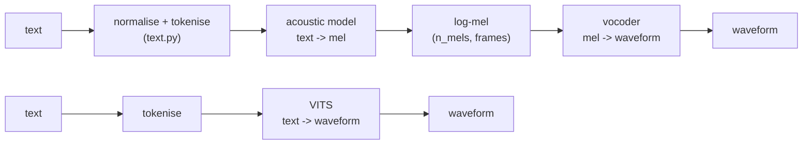

# Architecture: every approach, and why it looks the way it does

The repo is a workbench for understanding text-to-speech. Each model is written in plain
PyTorch with the sizes kept small (0.3 - 2 M parameters by default) so that the code is
readable and a run on a CPU or a free GPU shows the behaviour of the method, not a benchmark
score. This page explains what each component does, the shapes that flow through it, and the
trade-offs; the code file at the top of each section is the authoritative reference.

## The pipeline every model shares



- **Text front-end** (`src/tts/text.py`): `"I have 3 cats."` -> `"i have three cats."` -> ids
  `[..., 1]`; id 0 is padding, id 1 the end-of-sentence symbol `~`. Characters by default; ARPAbet
  phonemes with `--tokenizer phoneme` (needs `g2p-en`). Phonemes remove spelling ambiguity
  ("read" vs "read") at the cost of a dictionary.
- **Mel-spectrogram** (`src/tts/audio.py`): the STFT magnitude (`n_fft/2 + 1` bins per frame,
  one frame every `hop_length` samples) multiplied by a triangular mel filterbank and
  log-compressed. `(batch, n_mels, frames)` everywhere, `frames = samples // hop_length`.
  The mel is a compact, perceptual, phase-free picture of the sound: easy for a network to
  predict, and (with a vocoder) enough to rebuild audio.

## Three families of acoustic models

| | Tacotron 2 | Transformer-TTS | FastSpeech 2 | VITS |
|---|---|---|---|---|
| file | `tacotron2.py` | `transformer_tts.py` | `fastspeech2.py` | `vits.py` |
| generation | autoregressive, frame group by frame group | autoregressive | all frames at once | all frames at once, waveform directly |
| text/frame alignment | learned by attention | learned by attention | given by durations (built-in aligner or a teacher) | MAS on the latent |
| inference cost | O(T) sequential steps | O(T) steps, each O(T) | one pass | one pass |
| failure modes | skipped/repeated words, babbling past the end | same, worse without guided attention | flat prosody if the predictors are weak | GAN training instability |
| control | none | none | duration / pitch / energy knobs | duration, temperature |
| output | mel | mel | mel | waveform |

### Tacotron 2 (`src/tts/tacotron2.py`)

```
ids (B, N) -> Embedding -> 3 x [Conv1d(k=5) + BatchNorm + ReLU] -> BiLSTM -> memory h (B, N, H)
decoder step t (r mel frames per step):
    p_t       = PreNet(previous frame)                                (B, prenet_dim)
    s_t       = AttentionLSTM([p_t ; c_{t-1}])                        (B, H)
    e_{t,i}   = v^T tanh(W s_t + V h_i + U f_{t,i}),  f_t = conv([alpha_{t-1} ; cumsum alpha])
    alpha_t   = softmax_i(e_{t,i})          (location-sensitive attention)
    c_t       = sum_i alpha_{t,i} h_i                                 (B, H)
    d_t       = DecoderLSTM([s_t ; c_t])
    mel_t     = Linear([d_t ; c_t]) -> (B, r, n_mels);   stop_t = Linear([d_t ; c_t])
mel          = mel + PostNet(mel)      (5-tap conv stack predicting a residual)
```

Why these pieces:

- **PreNet with dropout always on.** The decoder is trained with *teacher forcing* (the true
  previous frame is given). Without the information bottleneck of a dropout-ed prenet the
  decoder would learn to copy the previous frame and ignore the text; at inference, when it
  must feed on its own output, it would drift.
- **Location-sensitive attention.** The energies look at the *previous* alignment through a
  convolution, so "move a bit to the right" is an easy function to learn. This is what makes
  attention roughly monotonic without ever enforcing it. The cumulative alignment tells the
  model what has already been read (fewer repeats).
- **Stop token.** A sigmoid that fires at the last frame group; without it the decoder would
  have to learn silence forever. It is up-weighted in the loss because it is positive once per
  sentence.
- **Reduction factor r.** Predicting r frames per step divides the number of decoder steps by r:
  faster, and attention has fewer chances to lose its place. r = 2 by default.
- **Guided attention loss** (`layers.guided_attention_loss`): a penalty on attention mass far
  from the diagonal, `W[t, n] = 1 - exp(-(n/N - t/T)^2 / 2 sigma^2)`. Not in the original
  paper, but it makes alignment appear in hundreds of steps instead of tens of thousands.

Losses: MSE before and after the postnet, BCE on the stop token, guided attention.

### Transformer-TTS (`src/tts/transformer_tts.py`)

Same idea, but the LSTMs become self-attention and the location attention becomes ordinary
cross-attention:

```
encoder: Embedding -> conv prenet -> + alpha * PositionalEncoding -> L x FFTBlock (self-attn + conv FFN)
decoder: previous frames -> PreNet -> + PositionalEncoding
         -> L x [causal self-attn ; cross-attn(memory) ; FFN] -> Linear -> r frames + stop ; PostNet
```

- The positional encoding has a learned scale `alpha` because text and mel sequences have very
  different lengths and the encoding must fit both.
- Training is parallel over time (one causal mask); inference is still sequential and, as
  written here, re-runs the decoder on the whole prefix each step (simple, O(T^2)).
- Nothing in cross-attention prefers monotonic alignments, so the guided-attention loss and
  the diagonal plot matter even more than for Tacotron 2.

### FastSpeech 2 (`src/tts/fastspeech2.py`)

```
ids -> Embedding + PE -> L x FFTBlock -> h (B, N, H)
variance adaptor:
    log d_n = DurationPredictor(h)      # frames per symbol
    p_n     = PitchPredictor(h)         # log-F0 of the symbol (target = mean over its frames)
    e_n     = EnergyPredictor(h)        # log-energy of the symbol
    h       = h + Conv(p) + Conv(e)     # targets during training, predictions at inference
LengthRegulator: repeat h_n  d_n times          -> (B, T, H)
+ PE -> L x FFTBlock -> Linear -> mel ; + PostNet
```

- **No attention between text and frames**, so there is nothing to lose its place: no
  repeats, no skips, and the whole sentence comes out of one forward pass.
- **Durations** are the price. The original paper took them from Montreal Forced Aligner;
  FastSpeech 1 took them from a Tacotron teacher. Here they come from a small **aligner**
  trained jointly (`align.py`, see [alignment.md](alignment.md)), or from a Tacotron 2
  checkpoint with `--duration-source teacher`.
- **Pitch and energy** are *variance information* that the text does not determine; adding
  them as inputs during training (targets) removes a one-to-many ambiguity and makes the mel
  loss meaningful, and predicting them gives knobs at inference.
- The FFT block uses a **1-D convolution** in its feed-forward part because neighbouring
  phonemes matter for pronunciation; a per-position linear layer cannot see them.

Losses: L1 mel before/after postnet, MSE on log-duration, pitch and energy, plus the aligner's
forward-sum and binarisation losses.

### VITS (`src/tts/vits.py`)

VITS is a conditional variational autoencoder whose decoder is a HiFi-GAN generator, so it
produces the waveform directly and is trained with the vocoder's GAN losses, plus a
normalising flow to make the prior expressive and MAS to align text and frames.

```
training
  linear spectrogram -> PosteriorEncoder (WaveNet stack) -> mu_q, logs_q ; z ~ N(mu_q, exp logs_q)   (B, C, T)
  z -> Flow (affine coupling layers, mean-only) -> z_p
  text -> FFT encoder -> mu_p, logs_p                                                                 (B, C, N)
  alignment = MAS( log N(z_p[t] ; mu_p[n], logs_p[n]) )  -> durations d_n, expanded mu_p, logs_p over T
  KL  = KL( N(z_p ; ., logs_q) || N(mu_p, logs_p) )
  dur = MSE( DurationPredictor(text), log(1 + d_n) )
  slice of z -> HiFiGANGenerator -> wav_hat ; mel L1 + LS-GAN + feature matching vs the real slice
inference
  text -> mu_p, logs_p, durations -> expand -> z_p = mu_p + eps * exp(logs_p) * temperature
       -> Flow^-1 -> z -> HiFiGANGenerator -> waveform
```

- The **posterior encoder** sees the *linear* spectrogram (more detail than the mel) and
  produces a latent that the decoder can turn into audio almost perfectly; this is the
  "autoencoder" half.
- The **flow** is a stack of invertible coupling layers: during training it maps the posterior
  latent into the space where the text prior lives (KL is computed there); at inference it is
  run backwards. The coupling layers are *mean-only* (volume preserving), so no log-det term.
- **MAS** on the likelihood of `z_p` under each text position's Gaussian gives the alignment
  without any attention module; the duration predictor learns to reproduce it for inference.
- Only a random **slice** of the latent (`segment_frames`) is decoded to audio in each step;
  the GAN losses are expensive at the sample level and a slice is enough.
- Simplification kept on purpose: the paper's *stochastic* duration predictor (a flow over
  durations) is replaced by the deterministic FastSpeech-style predictor.

### Multi-speaker

Every model has a `SpeakerEmbedding` (`layers.py`): a learned vector per speaker, projected and
added to the encoder output. It is a no-op for `n_speakers = 1`; `speakers.csv` in the data
folder turns it on. Zero-shot speaker cloning (an external speaker encoder) is out of scope.

## Vocoders (`src/tts/vocoders.py`)

- **Griffin-Lim** (`audio.griffin_lim`): the log-mel is inverted to a linear magnitude with the
  pseudo-inverse of the filterbank, then the phase is found by iterating
  `spec = |target| * phase(STFT(ISTFT(spec)))`. No parameters, works at once, sounds buzzy
  (phase is only approximately consistent). Baseline for everything.
- **HiFi-GAN**: `mel (B, n_mels, T) -> Conv -> [ConvTranspose(x8) -> MRF] -> [x4 -> MRF] -> [x4 -> MRF] -> Conv -> tanh -> (B, T * 128)`
  where MRF (multi-receptive-field fusion) is the average of residual stacks with different
  kernel sizes and dilations, so the generator sees both short and long patterns. It is
  trained with two discriminator families: **MPD** reshapes the waveform into
  `(period, T/period)` for periods 2, 3, 5, 7, 11 (each sub-discriminator sees a different
  periodicity, which is what pitched sound is made of) and **MSD** looks at the raw, 2x and
  4x downsampled waveform with 1-D convolutions. Losses (`losses.py`): least-squares GAN,
  feature matching (L1 between the discriminators' hidden activations on real and generated
  audio: a perceptual reconstruction loss), and 45 x mel L1.
  Train it on the same data as the acoustic model (`tts-train --model hifigan`) and chain it
  with `tts-synthesize --vocoder hifigan --vocoder-checkpoint ...`.

## Sizes

With the defaults (`hidden = 128`, 2 blocks, 8 kHz / 64 mels):

| model | parameters |
|---|---|
| tacotron2 | ~ 1.0 M |
| transformer_tts | ~ 1.0 M |
| fastspeech2 (+ aligner) | ~ 0.9 M |
| vits (+ HiFi-GAN decoder) | ~ 0.9 M |
| hifigan generator / discriminators | ~ 0.25 M / ~ 0.18 M |

Scale with `--hidden 256 --layers 4 --upsample-initial 128` and the 22.05 kHz audio settings for
LJSpeech (see [training.md](training.md)).
